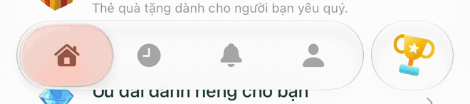
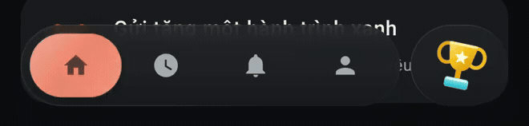
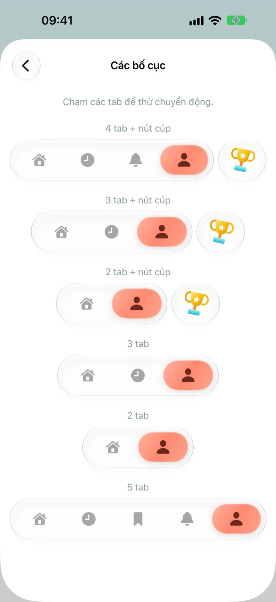
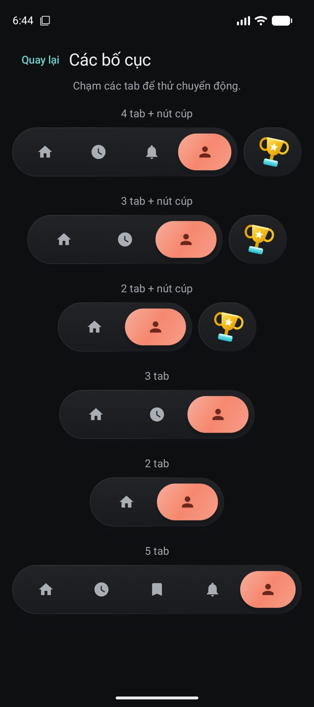

# LiquidTabView

**English** · [Tiếng Việt](README.vi.md)

A custom tab view with a glass capsule that supports tapping and press-and-drag selection. **Drop one Swift or Kotlin file into your project**, then provide your tabs and selection state.

- 2–5 tabs, with a bar that sizes itself to the tab count.
- Light and dark modes, a configurable `tint`, custom tab icons, and an optional action button.
- Continuous capsule position and velocity when changing direction; dragging commits the selection on release.
- `LiquidTabView` manages pages and bottom insets; `LiquidTabBar` works with your existing navigation.

## Preview

**iOS — Coral, light mode:** hold the capsule, move across distant tabs, and return.



[Watch the iOS MP4](docs/media/ios-interaction.mp4)

**Android — Coral, dark mode:** drag the capsule from the first tab to the last and back.



[Watch the Android MP4](docs/media/android-interaction.mp4)

These clips are cropped from actual demo recordings, played at real-time speed and exported at 30 fps. They illustrate interaction, not measured rendering performance. The iOS clip shows separate hold and swipe gestures; Android shows a continuous drag in each direction. The recorded demo UI uses Vietnamese labels; the integration examples below use English.

<details>
<summary><strong>Six layouts — with and without an action button</strong></summary>

<table>
  <tr><th>SwiftUI · Light</th><th>Compose · Dark</th></tr>
  <tr>
    <td></td>
    <td></td>
  </tr>
</table>

Screenshots show each layout after selecting its last tab and letting the animation settle. The trophy button and pages are caller-provided demo content; the component does not depend on them.

</details>

## Installation

| Platform | File to copy | Requirements |
| --- | --- | --- |
| SwiftUI | [LiquidTabView.swift](LiquidTabView.swift) | iOS 26+, Swift 6, iOS 26+ SDK |
| Jetpack Compose | [LiquidTabView.kt](LiquidTabView.kt) | Android 12 / API 31+, Compose UI, Foundation, Animation, and Material3 |

**iOS:** add the Swift file to your app target. The iPhone and Simulator shaders are embedded in the file; no separate assets, Metal file, or build script is required.

**Android:** add the Kotlin file to your source set and change `package studio.greenglass.demo` to your project's package. The demo was built with Compose BOM `2026.06.01` and compile SDK 36; compatibility with older BOMs has not been verified. AGSL refraction requires API 33+. API 31–32 use a tinted, scaling capsule with backdrop blur.

Download an individual file using GitHub's **Download raw file** button, or clone the repository:

```sh
git clone https://github.com/quyendang/LiquidTabView.git
```

This repository contains the components and documentation, without the demo app projects or APK. Copy only the file for your platform.

## SwiftUI

```swift
import SwiftUI

enum AppTab: Hashable { case home, saved, profile }

struct AppRoot: View {
    @State private var selected: AppTab = .home
    @State private var showCompose = false

    var body: some View {
        LiquidTabView(
            selection: $selected,
            tabs: [
                LiquidTab("Home", systemImage: "house.fill", value: .home),
                LiquidTab("Saved", systemImage: "bookmark.fill", value: .saved),
                LiquidTab("Profile", systemImage: "person.fill", value: .profile)
            ],
            tint: Color(red: 1, green: 138.0 / 255, blue: 112.0 / 255),
            action: LiquidTabAction("Create", systemImage: "plus") { showCompose = true }
        ) { tab in
            NavigationStack {
                switch tab {
                case .home: Text("Home").navigationTitle("Home")
                case .saved: Text("Saved").navigationTitle("Saved")
                case .profile: Text("Profile").navigationTitle("Profile")
                }
            }
        }
        .sheet(isPresented: $showCompose) { Text("Create") }
    }
}
```

- Each tab has its own view tree, preserving `@State` and `NavigationStack` when switching tabs. The caller owns `selection`; programmatic binding changes also animate.
- `LiquidTabView` uses `safeAreaInset` so a `ScrollView` or `List` can account for the bar. Place a `NavigationStack` **inside each tab** for independent navigation.
- Custom image: `LiquidTab("Saved", image: Image("savedIcon"), value: .saved)`. Icons scale to fit a 22-point frame. Use template rendering for tintable assets.
- Custom action: `LiquidTabAction("Create", action: openComposer) { Image(systemName: "plus.circle.fill") }`. The label can be any view, including a multicolor image.
- Omit `action` to remove the button and its spacing. Set `iconTint` to override the icon color inside the resting capsule; its default is derived from `tint`.
- To manage navigation and insets yourself, use `LiquidTabBar(selection:tabs:tint:iconTint:action:reduceMotion:)` in an overlay or `safeAreaInset`. The bar is 64 points tall; the caller supplies outer spacing and padding.
- The component follows the environment's color scheme and supports Reduce Motion and Reduce Transparency. You can also pass `reduceMotion: true` directly.
- For ProMotion displays, you can set `CADisableMinimumFrameDurationOnPhone = YES` in Info.plist. This does not guarantee 120 fps.

## Kotlin / Compose

```kotlin
import androidx.compose.foundation.layout.*
import androidx.compose.material.icons.Icons
import androidx.compose.material.icons.filled.*
import androidx.compose.material3.*
import androidx.compose.runtime.*
import androidx.compose.runtime.saveable.rememberSaveable
import androidx.compose.ui.Modifier
import androidx.compose.ui.graphics.Color

@Composable
fun AppRoot() {
    var selected by rememberSaveable { mutableStateOf("home") }
    var composing by rememberSaveable { mutableStateOf(false) }
    val tabs = listOf(
        LiquidTab("home", "Home") { Icon(Icons.Default.Home, null) },
        LiquidTab("saved", "Saved") { Icon(Icons.Default.Favorite, null) },
        LiquidTab("profile", "Profile") { Icon(Icons.Default.Person, null) }
    )
    LiquidTabView(
        selectedTab = selected,
        onTabSelected = { selected = it },
        tabs = tabs,
        tint = Color(0xFFFF8A70),
        action = LiquidTabAction("Create", { composing = true }) {
            Icon(Icons.Default.Add, null)
        }
    ) { tab, padding ->
        Box(Modifier.fillMaxSize().padding(padding)) {
            Text(when (tab) {
                "home" -> "Home"
                "saved" -> "Saved"
                else -> "Profile"
            })
        }
    }
    if (composing) {
        AlertDialog(onDismissRequest = { composing = false },
            title = { Text("Create") },
            confirmButton = { TextButton(onClick = { composing = false }) { Text("Close") } })
    }
}
```

- Tab icons are composable slots. The component does not depend on `material-icons-extended`. The example uses Material icons; you can use `Icon(painterResource(R.drawable.ic_home), null)` or your project's icon library instead.
- The icon slot is 22 dp. Let `Icon` inherit its tint from `LocalContentColor`; specifying a tint inside the slot overrides the regular icon layer's color. The refraction layer uses the icon's alpha mask to apply the capsule's icon tint.
- Page content receives bottom `PaddingValues`. For a `LazyColumn`, pass these as `contentPadding` to let content scroll behind the glass. Do not add the navigation-bar inset a second time; the page still owns its status-bar inset.
- `LiquidTabView` records the backdrop and preserves saveable page state through `SaveableStateHolder`. Use `rememberSaveable` for state that should survive tab changes. Plain `remember` state is lost when the page leaves composition. Your project still owns navigation, back stacks, and ViewModels.
- Use a String, Int, enum, or another Android-saveable type for tab IDs. Keep IDs stable across recompositions.
- Omit `action` or pass `null` to hide the button. `iconTint` controls resting icons. `dark` follows the system by default; pass `dark = appDarkMode` when your app has its own theme setting.
- `reduceMotion` or a system animation scale of zero disables motion.
- API 33+ uses AGSL refraction. API 31–32 retain the tinted/scaling capsule and backdrop blur, without the refraction shader.
- Use `LiquidTabBar` directly if your project already owns a content layer. Its `backdrop` must record **only the page**, not the tab bar itself, and must start at the root coordinate origin. Use `LiquidTabView` to manage this automatically, including when its container has padding.

## Behavior and configuration

Provide 2–5 tabs with unique IDs, and ensure the selected ID belongs to the list. If a list update removes the selected tab, update the selection to a remaining ID in the same update. Invalid configuration fails early instead of placing the capsule over the wrong tab. Tabs currently appear in list order from left to right, with the optional action button on the right.

Tap to select a tab. Press and drag to move the capsule, then release to commit the selection. Releasing outside the allowed area cancels the change. Badges, labels beneath icons, hidden tabs, and a More menu are not included.

Swift uses native Liquid Glass and a compiled icon shader, with separate iPhone and Simulator libraries embedded in the Swift file. The Base64 blocks contain those shaders. Leave them unchanged when customizing colors, icons, or tabs. The original Metal source is available in [`maintenance/liquidLens.metal`](maintenance/liquidLens.metal) for maintenance; **you do not need to copy it into your app**. Android keeps the AGSL shader as a string inside the Kotlin file.

The API exposes tabs, selection, tint/iconTint, an optional action, and reduced motion. Compose also exposes modifier, dark mode, and backdrop parameters where applicable. The spring/tracking model and glass rendering stay private or internal to each file.

## Validation and limitations

The demo passed Xcode builds for iOS Simulator and generic iPhone devices, Swift motion checks, and eight Android JUnit tests. The two distributed files are byte-for-byte identical to the components used in that demo. See the [validation notes](docs/VALIDATION.md).

The component has run on iOS 26.3/27 Simulators and an Android 17 Emulator; the demo APK was also installed on a Pixel 7. FPS and latency have not been measured, and physical iPhone testing and visual QA on Android 12–12L remain outstanding. The platforms do not promise pixel-identical rendering: iOS uses native Liquid Glass, while Android uses backdrop blur and AGSL.
