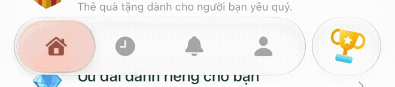
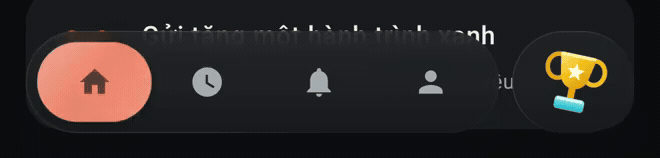
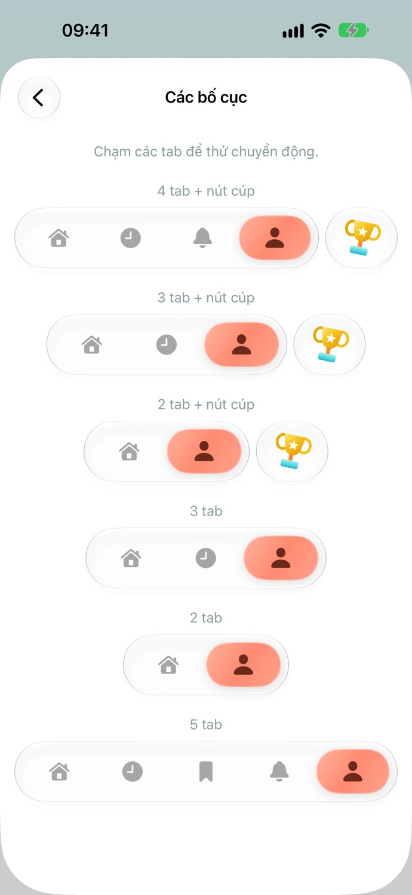
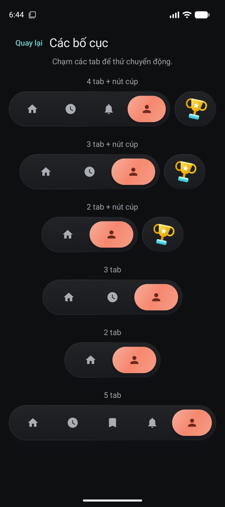

# LiquidTabView

[English](README.md) · **Tiếng Việt**

Custom tab view với capsule kính, hỗ trợ chạm và giữ/rê để đổi tab. **Copy một file Swift hoặc một file Kotlin vào project**, truyền danh sách tab và selection của bạn.

- 2–5 tab; tự thu gọn chiều rộng theo số tab.
- Light/dark mode, đổi màu qua `tint`, icon tab và nút phụ tùy chỉnh.
- Capsule giữ liên tục vị trí/vận tốc khi đổi đích; thả tay mới chọn tab.
- `LiquidTabView` quản lý trang và vùng an toàn; `LiquidTabBar` dùng riêng với navigation có sẵn.

## Xem thử

**iOS — Coral, light mode:** giữ capsule, chuyển qua tab xa rồi quay lại.



[Video iOS MP4](docs/media/ios-interaction.mp4)

**Android — Coral, dark mode:** rê capsule từ tab đầu sang tab cuối và trở lại.



[Video Android MP4](docs/media/android-interaction.mp4)

GIF/video được cắt từ bản ghi demo thực tế, giữ tốc độ thời gian thực và xuất 30fps. Đây là minh họa tương tác, không phải phép đo FPS. iOS minh họa thao tác giữ rồi swipe; Android minh họa một lần kéo liên tục theo mỗi hướng.

<details>
<summary><strong>6 bố cục — có và không có nút phụ</strong></summary>

<table>
  <tr><th>SwiftUI · Light</th><th>Compose · Dark</th></tr>
  <tr>
    <td></td>
    <td></td>
  </tr>
</table>

Ảnh chụp sau khi chọn tab cuối ở từng bố cục. Nút cúp và các trang là nội dung demo do caller cung cấp; component không phụ thuộc vào chúng.

</details>

## Cài đặt

| Nền tảng | File cần copy | Yêu cầu |
| --- | --- | --- |
| SwiftUI | [LiquidTabView.swift](LiquidTabView.swift) | iOS 26+, Swift 6, SDK iOS 26+ |
| Jetpack Compose | [LiquidTabView.kt](LiquidTabView.kt) | Android 12 / API 31+, Compose UI/Foundation/Animation và Material3 |

**iOS:** thêm file Swift vào app target. Shader cho iPhone và Simulator đã nhúng trong file; không cần asset, file Metal hay build script riêng.

**Android:** thêm file Kotlin vào source set và đổi dòng `package studio.greenglass.demo` cho đúng project. Demo đã build bằng Compose BOM `2026.06.01`, compile SDK 36; chưa xác nhận mọi BOM cũ. AGSL refraction cần API 33+; API 31–32 dùng capsule màu/scale cùng backdrop blur.

Có thể tải từng file bằng nút **Raw → Download**, hoặc clone repo:

```sh
git clone https://github.com/quyendang/LiquidTabView.git
```

Repo phân phối component và tài liệu, không kèm project demo hoặc APK. Chỉ cần copy file của nền tảng bạn dùng.

## SwiftUI

```swift
import SwiftUI

enum AppTab: Hashable { case home, saved, profile }

struct AppRoot: View {
    @State private var selected: AppTab = .home
    @State private var showCompose = false

    var body: some View {
        LiquidTabView(
            selection: $selected,
            tabs: [
                LiquidTab("Trang chủ", systemImage: "house.fill", value: .home),
                LiquidTab("Đã lưu", systemImage: "bookmark.fill", value: .saved),
                LiquidTab("Tài khoản", systemImage: "person.fill", value: .profile)
            ],
            tint: Color(red: 1, green: 138.0 / 255, blue: 112.0 / 255),
            action: LiquidTabAction("Tạo mới", systemImage: "plus") { showCompose = true }
        ) { tab in
            NavigationStack {
                switch tab {
                case .home: Text("Trang chủ").navigationTitle("Trang chủ")
                case .saved: Text("Đã lưu").navigationTitle("Đã lưu")
                case .profile: Text("Tài khoản").navigationTitle("Tài khoản")
                }
            }
        }
        .sheet(isPresented: $showCompose) { Text("Tạo mới") }
    }
}
```

- Mỗi tab có cây view riêng, giữ `@State` và `NavigationStack` khi chuyển tab. `selection` thuộc caller; đổi binding từ code vẫn có animation.
- `LiquidTabView` dùng `safeAreaInset`; ScrollView/List nhận vùng an toàn cho bar. Đặt `NavigationStack` **trong từng tab** nếu muốn giữ navigation riêng.
- Icon asset: `LiquidTab("Đã lưu", image: Image("savedIcon"), value: .saved)`. Component scale-to-fit trong khung 22pt; dùng asset template để tint áp dụng.
- Nút phụ custom: `LiquidTabAction("Tạo mới", action: openComposer) { Image(systemName: "plus.circle.fill") }`. Label có thể là bất kỳ View, kể cả hình nhiều màu.
- Bỏ `action` để không hiện nút và khoảng trống bên phải. Dùng `iconTint` nếu muốn tự chọn màu icon bên trong capsule khi nghỉ. Màu mặc định được tính từ `tint`.
- Tự xử lý navigation/safe area: dùng `LiquidTabBar(selection:tabs:tint:iconTint:action:reduceMotion:)` trong overlay hoặc `safeAreaInset`. Bar cao 64pt; caller thêm khoảng cách và padding.
- Theo light/dark của môi trường; hỗ trợ Reduce Motion và Reduce Transparency. Có thể truyền `reduceMotion: true` riêng.
- Với màn hình ProMotion, có thể bật `CADisableMinimumFrameDurationOnPhone = YES` trong Info.plist. Đây không phải cam kết đạt 120fps.

## Kotlin / Compose

```kotlin
import androidx.compose.foundation.layout.*
import androidx.compose.material.icons.Icons
import androidx.compose.material.icons.filled.*
import androidx.compose.material3.*
import androidx.compose.runtime.*
import androidx.compose.runtime.saveable.rememberSaveable
import androidx.compose.ui.Modifier
import androidx.compose.ui.graphics.Color

@Composable
fun AppRoot() {
    var selected by rememberSaveable { mutableStateOf("home") }
    var composing by rememberSaveable { mutableStateOf(false) }
    val tabs = listOf(
        LiquidTab("home", "Trang chủ") { Icon(Icons.Default.Home, null) },
        LiquidTab("saved", "Đã lưu") { Icon(Icons.Default.Favorite, null) },
        LiquidTab("profile", "Tài khoản") { Icon(Icons.Default.Person, null) }
    )
    LiquidTabView(
        selectedTab = selected,
        onTabSelected = { selected = it },
        tabs = tabs,
        tint = Color(0xFFFF8A70),
        action = LiquidTabAction("Tạo mới", { composing = true }) {
            Icon(Icons.Default.Add, null)
        }
    ) { tab, padding ->
        Box(Modifier.fillMaxSize().padding(padding)) {
            Text(when (tab) {
                "home" -> "Trang chủ"
                "saved" -> "Đã lưu"
                else -> "Tài khoản"
            })
        }
    }
    if (composing) {
        AlertDialog(onDismissRequest = { composing = false },
            title = { Text("Tạo mới") },
            confirmButton = { TextButton(onClick = { composing = false }) { Text("Đóng") } })
    }
}
```

- Component dùng slot icon, không phụ thuộc `material-icons-extended`. Ví dụ dùng Material icons; có thể thay bằng `Icon(painterResource(R.drawable.ic_home), null)` hoặc icon library của project.
- Icon slot có khung 22dp. Để `Icon` dùng tint mặc định từ `LocalContentColor`; tự gán tint bên trong slot sẽ ghi đè màu ở lớp icon thường. Lớp khúc xạ vẫn dùng mask alpha của icon để tô theo tint của capsule.
- Nội dung nhận `PaddingValues` đáy. Với `LazyColumn`, truyền vào `contentPadding` để vẫn cuộn được phía dưới kính. Không cộng lại navigation-bar inset này lần thứ hai; status-bar inset vẫn thuộc trang.
- `LiquidTabView` tự ghi backdrop nền và giữ state qua `SaveableStateHolder`. State trang cần `rememberSaveable`; `remember` đơn thuần không được giữ sau khi trang rời composition. Navigation/back stack/ViewModel vẫn do project quản lý.
- ID dùng String, Int, enum hoặc kiểu saveable của Android. Không thay ID mỗi lần recomposition.
- `action = null` hoặc bỏ tham số để ẩn nút. `iconTint` chỉnh icon nghỉ; `dark` mặc định theo hệ thống. Nếu app có theme riêng, truyền `dark = appDarkMode`.
- `reduceMotion` hoặc system animation scale bằng 0 sẽ bỏ chuyển động.
- API 33+ dùng AGSL refraction. API 31–32 giữ capsule màu/scale và backdrop blur; không có shader refraction như Android 13+.
- Dùng `LiquidTabBar` riêng khi project đã sở hữu content layer. Tham số `backdrop` phải ghi **chỉ trang**, không ghi chính tabbar, và layer phải bắt đầu ở gốc root coordinate. Dùng `LiquidTabView` nếu muốn component tự xử lý phần này, kể cả khi container có padding.

## Quy ước chung

2–5 tab, ID duy nhất, selection phải có trong danh sách. Khi đổi danh sách mà loại tab đang chọn, đổi selection sang một ID còn tồn tại trong cùng cập nhật. Sai cấu hình sẽ báo lỗi sớm thay vì hiển thị capsule sai tab. Thứ tự hiển thị hiện theo danh sách từ trái sang phải; nút phụ ở bên phải.

Chạm đổi tab; giữ/rê điều khiển capsule; thả mới commit selection. Thả ngoài vùng cho phép thì hủy. Không có badge, nhãn dưới icon, tab ẩn hay nút More. Chỉ thêm chúng khi sản phẩm cần.

Swift dùng native Liquid Glass và shader icon đã biên dịch, nhúng hai thư viện cho iPhone/Simulator ở cuối vùng UI trong file. Khối Base64 là shader, không phải logic dư. Không sửa khối này nếu chỉ đổi màu/icon/tab. Metal source gốc được lưu để bảo trì tại [`maintenance/liquidLens.metal`](maintenance/liquidLens.metal); **không cần copy** file đó để sử dụng component. Android giữ shader AGSL dạng chuỗi ngay trong Kotlin.

API được giữ nhỏ: tab, selection, tint/iconTint, action, reduceMotion; Android thêm modifier/dark/backdrop cho nhu cầu của Compose. Mô hình spring/tracking và phần dựng kính nằm private/internal trong cùng file. Không thay bằng animation tuyến tính chỉ để giảm số dòng.

## Kiểm chứng và giới hạn

Đã build bằng Xcode cho iOS Simulator và generic iPhone device; Swift motion checks và 8 Android JUnit tests đều đạt. Hai file này giống byte với component trong demo đã kiểm tra. Xem [chi tiết kiểm chứng](docs/VALIDATION.md).

Đã chạy trên iOS 26.3/27 Simulator, Android 17 Emulator và cài APK demo lên Pixel 7. Chưa đo FPS/latency, chưa kiểm tra trên iPhone thật hoặc visual QA Android 12–12L. Không cam kết khớp từng pixel với tabbar Apple; iOS dùng Liquid Glass native, Android dùng backdrop blur và AGSL.
